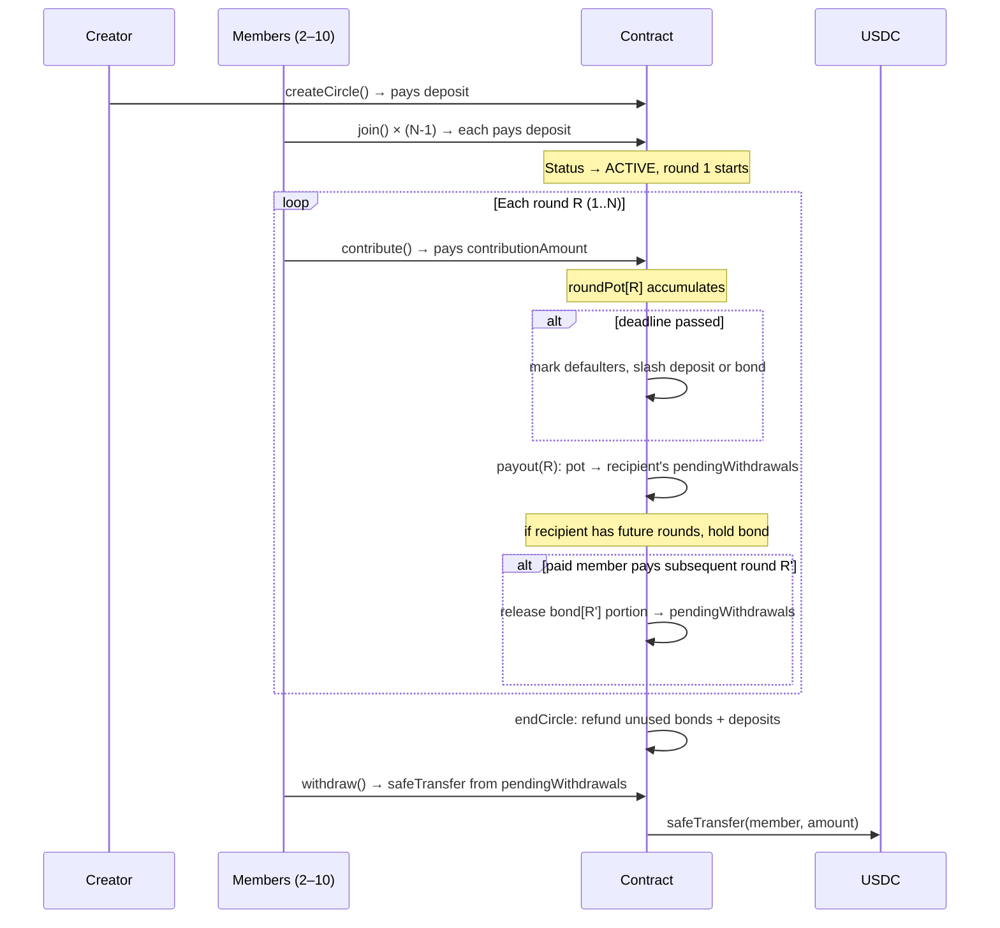

# AjoCircle v2 — Design Document

**Status:** Draft  
**Target chain:** Arc Testnet (chain ID 5042002), EVM-compatible  
**Language/toolchain:** Solidity ^0.8.20 / Foundry  
**Milestone:** Bond-mechanics upgrade (Fix 3)

**Review tracker:**
- [ ] Design review
- [ ] Security review
- [ ] Ops review

---

## Action Items (living)

- TBD after review rounds.

---

## Goals / Non-Goals

### Goals
1. Rotating savings group (ajo/esusu) in USDC — every member contributes each round, one member receives the full pot per round.
2. **Fairness for late recipients:** early recipients must remain incentivised to keep paying after they have already been paid.
3. **Payout bond:** when a member receives the pot, hold back `(remaining rounds they still owe × contributionAmount)` as a locked bond. Release one portion back to them as they pay each subsequent round. The last recipient owes nothing after payout, so gets the full pot.
4. **Default after payout:** if a paid member misses a round, slash one contribution from their bond and credit it directly to that round's recipient.
5. **Default before payout:** if an unpaid member misses a round, slash their security deposit by one contribution to that round's recipient; they keep their payout slot if their remaining deposit is non-zero, otherwise are permanently excluded.
6. **Recipient also defaults:** they still receive all other contributions plus any slashed amounts; only their own missed share is deducted.
7. **No orphan-pot redistribution:** remove the old "redistribute to good-standing members" path entirely.
8. **Cycle end:** refund all unused bonds and unused deposits to their owners.

### Non-Goals
- Cross-chain / bridging.
- Upgradeability (immutable contract).
- Admin / owner keys.
- Randomised payout order (removed: `block.prevrandao` is always 0 on Arc Testnet).
- Frontend changes (handled separately).

---

## Requirements

### Functional
1. Creator creates a circle; joins automatically as first member, paying `contributionAmount` as deposit.
2. Any address may join a PENDING circle (up to `memberCount`); pays `contributionAmount` as deposit on join.
3. Circle starts automatically when `memberCount` members have joined.
4. Each active round: members call `contribute()` to pay `contributionAmount` into the round pot.
5. `payout()` may be called once all active members have contributed, or after the round deadline.
6. After deadline: defaulting members (who haven't already defaulted) are marked. If they have not yet been paid out (no bond), their deposit is slashed by `contributionAmount` and added to the round pot. If they have been paid out (have a bond), their bond is slashed by `contributionAmount` and added to the round pot.
7. The round's designated recipient receives the pot. If the recipient itself defaulted, it still receives the pot less its own missed contribution.
8. After a paid member contributes a round, release `contributionAmount` back from their bond to `pendingWithdrawals`.
9. At cycle end, refund all remaining bond balances and remaining deposit balances to `pendingWithdrawals`.
10. Creator may cancel a PENDING circle; all deposits are refunded.
11. `withdraw()` drains `pendingWithdrawals[msg.sender]` via pull pattern.

### Security
- No path lets a non-member contribute or trigger payout.
- No path lets a member contribute twice in the same round.
- No path lets a defaulted member re-participate.
- `pendingWithdrawals` is the sole external-transfer surface; no push-transfer elsewhere.
- All external ERC-20 calls use `SafeERC20`.
- `nonReentrant` on every function that calls `safeTransferFrom` or `safeTransfer`.
- No integer overflow (Solidity 0.8.x checked arithmetic throughout).
- Loop bounds are bounded by `memberCount` (max 10).

---

## Terminology & Actors

| Term | Definition |
|------|------------|
| Circle | A single rotating-savings group instance, identified by a `uint256 circleId`. |
| Member | An address that has joined and paid the deposit. |
| Deposit | The `contributionAmount` locked at `join()`. Covers missed pre-payout rounds. |
| Bond | Locked-back portion of a payout. `(rounds remaining at payout time × contributionAmount)`. Covers missed post-payout rounds. |
| Round | One contribution cycle. Each round has exactly one payout recipient. |
| Payout recipient | The member whose turn it is to receive the pot in the current round (determined by join order). |
| Pot | Sum of all contributions (and slashed amounts) for the current round. |
| Defaulter | A member who misses the round deadline without having contributed. |
| Slash | Deduct `contributionAmount` from a defaulter's deposit or bond and add to the current round's pot. |

### Actors

| Actor | On/off-chain | Trust level | Powers |
|-------|-------------|------------|--------|
| Creator | On-chain EOA | Semi-trusted | Create circle, cancel PENDING circle, join as member |
| Member | On-chain EOA | Untrusted | Join, contribute, call payout, withdraw |
| Anyone | On-chain EOA | Untrusted | Call `payout()` (permissionless after deadline) |
| Contract | On-chain | N/A | Holds USDC deposits, bonds, and round pots; manages state |

No admin/owner key exists.

---

## Language / Runtime

- **Solidity ^0.8.20** — checked arithmetic, custom errors (gas-efficient reverts).
- **EVM target:** Cancun (Arc Testnet).
- **Toolchain:** Foundry (forge build, forge test).
- **Base contracts:** OpenZeppelin 5.x (`ReentrancyGuard`, `SafeERC20`, `IERC20`).

---

## Transaction & Execution Model

All state changes are atomic. Every function that touches USDC follows CEI (Checks-Effects-Interactions): all state is updated before any `safeTransfer`/`safeTransferFrom` call. `nonReentrant` guards every entry point that performs an ERC-20 call, providing defence-in-depth.

---

## Architecture Overview



### Flow of funds

| Step | Who moves what | Invariant |
|------|---------------|-----------|
| `join()` | Member → contract: `contributionAmount` | `deposits[id][member] = contributionAmount` |
| `contribute()` | Member → contract: `contributionAmount` | `roundPot[id][round] += contributionAmount` |
| Slash (post-payout) | `memberBond[id][member] -= c` → `roundPot[id][round] += c` | Bond decremented before pot incremented |
| Slash (pre-payout) | `deposits[id][member] -= c` → `roundPot[id][round] += c` | Deposit decremented before pot incremented |
| `payout()` | `roundPot → pendingWithdrawals[recipient]`; bond locked back | `pendingWithdrawals[recipient] += (pot - bond)`; `memberBond += bond` |
| Bond release | `memberBond -= c → pendingWithdrawals[member] += c` | After each post-payout contribution |
| `_endCircleAndRefund()` | Remaining bonds + deposits → `pendingWithdrawals` | All remaining locked amounts released |
| `withdraw()` | `pendingWithdrawals[msg.sender]` → member | Balance zeroed before transfer (CEI) |

**Resting-state invariant:** After `_endCircleAndRefund()` runs, the contract holds zero USDC attributable to this circle (all amounts are either in `pendingWithdrawals` or have been `withdraw()`n).

---

## Contract Design

### Roles

| Role | Holder | Permissions |
|------|--------|-------------|
| Creator | Deployer of a specific circle | Cancel PENDING circle only |
| Member | Any joined address | Contribute, call payout, withdraw |
| Anyone | Any EOA | Call payout (after deadline), withdraw own funds |

No owner, no admin, no upgradeability.

### New storage (v2 additions)

```
mapping(uint256 => mapping(address => uint256)) public memberDeposit;
// Remaining deposit held for a member in a given circle.
// Decremented when slashed (pre-payout) or refunded at cycle end.

mapping(uint256 => mapping(address => uint256)) public memberBond;
// Bond locked back from a payout.
// memberBond[circleId][member] = (roundsRemainingAtPayout × contributionAmount)
// Decremented by contributionAmount each time the member contributes a post-payout round.
// Decremented by contributionAmount when slashed for a missed post-payout round.
// Residual refunded at cycle end.
```

Removed: `collateralSlashed` mapping (replaced by per-round deposit/bond accounting).

### Key logic changes

**`_join`:**
- Transfer `contributionAmount` from member.
- Set `memberDeposit[circleId][member] = contributionAmount`.

**`contribute`:**
- After recording the contribution, if `memberBond[circleId][msg.sender] > 0`, release `contributionAmount` from bond to `pendingWithdrawals[msg.sender]`.

**`payout` (after deadline — defaulter slash):**
- For each defaulter:
  - If `memberBond[circleId][member] > 0` (already paid out): slash `min(contributionAmount, memberBond)` from bond → add to pot.
  - Else (not yet paid out): slash `min(contributionAmount, memberDeposit)` from deposit → add to pot. If deposit is now 0, permanently exclude them (`isDefaulted = true`).
  - Note: a member can default only once under the new logic (first missed round triggers the slash; they are marked `isDefaulted` regardless).

**`payout` (recipient selection and bond lock):**
- `recipient` = `payoutRecipients[round - 1]` (always, even if they defaulted — rule 4).
- `roundsRemainingAfterThis = memberCount - round` (rounds they still must contribute after receiving).
- `bond = roundsRemainingAfterThis × contributionAmount`.
- If `recipient` defaulted this round: `pot -= contributionAmount` (their own missed share deducted from what they receive — but only up to what is in the pot, to avoid underflow).
- `pendingWithdrawals[recipient] += (pot - bond)`.
- `memberBond[circleId][recipient] += bond`.

**`_endCircleAndRefund`:**
- For each member: release `memberBond[circleId][member]` + `memberDeposit[circleId][member]` to `pendingWithdrawals`.

**Removed:** `_redistributeOrphanPot`. There is no orphan pot path: the recipient always receives the pot (rule 4), even if they defaulted.

### Events (additions/changes)

| Event | Change |
|-------|--------|
| `BondLocked(uint256 circleId, address member, uint256 amount)` | New: emitted when bond is held back at payout |
| `BondReleased(uint256 circleId, address member, uint256 amount)` | New: emitted when bond portion released on contribution |
| `BondSlashed(uint256 circleId, address member, uint256 amount)` | New: emitted when bond slashed for missed post-payout round |
| `CollateralSlashed` | Renamed semantics: now only for pre-payout deposit slashes |

---

## Security Considerations

| Vulnerability | Applicable? | Mitigation |
|--------------|------------|-----------|
| Reentrancy | Yes | CEI ordering + `nonReentrant` on all external-call entry points |
| Access control | Yes | No privileged admin; creator can only cancel PENDING; all payout logic is permissionless after deadline |
| Integer overflow/underflow | Solidity ≥0.8 checked | Bond/deposit decrements use `min(amount, balance)` to prevent underflow from rounding |
| Unchecked external call | Yes | `SafeERC20` throughout; USDC is a known trusted token |
| Fee-on-transfer tokens | N/A | Only USDC (hardcoded constant) |
| Signature replay | N/A | No off-chain signatures |
| Front-running | Low | Payout is permissionless; no extractable MEV beyond normal transaction ordering |
| Flash-loan / oracle | N/A | No price oracle |
| Denial of service | Yes | Pull-over-push; loop bounded by `memberCount ≤ 10` |
| Timestamp dependence | Yes | Round deadline uses `block.timestamp`; 300s minimum duration; not used for randomness |
| Approval persistence | N/A | Contract never holds user approvals; members approve before calling |
| Centralization risk | No | No owner/admin key |
| Bond underflow on recipient-also-defaulted | Yes | `pot -= min(contributionAmount, pot)` to prevent underflow when recipient defaulted |

---

## Threat Model

| Actor | Worst-case compromise | Mitigation |
|-------|----------------------|-----------|
| Creator | Cancel pending circle (deposits refunded to members) | Only PENDING circles can be cancelled; funds returned to members, not creator |
| Malicious member | Default intentionally | Bond/deposit slashed exactly one contribution per missed round; cannot extract more than they locked |
| Malicious recipient | Default after receiving payout | Bond covers all remaining rounds; slash is per-round |
| Reentrancy attacker | Call withdraw() recursively | CEI: balance zeroed before transfer |

---

## Failure Scenarios

1. **All members default in round N (final round):** Each defaulter's bond/deposit is slashed into the pot. The recipient (whoever is slot N) receives the pot built from those slashes, even if they also defaulted (rule 4). Nobody gets nothing unless the pot itself is zero (all deposits were already exhausted).
2. **Recipient defaults before payout:** Their missed contribution is deducted from the pot they receive, but they still receive the rest.
3. **Early recipient stops paying:** Bond is slashed one contribution per missed round; each slash goes to that round's recipient. If the bond is exhausted, no further slash is possible (deposit was already used as bond so nothing is left). They are marked `isDefaulted` permanently.

---

## Testing Strategy

- Foundry unit tests (forge test): happy path, defaulter paths (pre- and post-payout), recipient-also-defaults, every-member-defaults-in-final-round, full cycle with bonds, cancel, fuzz on contribution amounts and member counts.
- Slither static analysis.
- Two-round security review at `max` severity.
- Deploy to Arc Testnet.

---

## Priorities & Tradeoffs

| Decision | Tradeoff | Rationale |
|----------|----------|-----------|
| Bond = `(remaining rounds × contribution)` locked at payout | Recipient receives less USDC immediately | Incentivises continued contribution; otherwise early payout recipients can exit costlessly |
| Recipient always receives pot (even if defaulted) | Slightly complex accounting | Fairness rule 4: recipient's own missed share is the only deduction |
| No orphan-pot redistribution | Some edge cases simpler | Removed a redistribution path that could reward paid-early members at the expense of later ones |
| Deposit AND bond as separate balances | Extra storage mapping | Conceptually clean: deposit is pre-payout security; bond is post-payout security |
| Single default per member (first miss = permanent exclusion) | Blunt but simple | Avoids complex re-entry logic; deposit/bond slashed on first miss |
