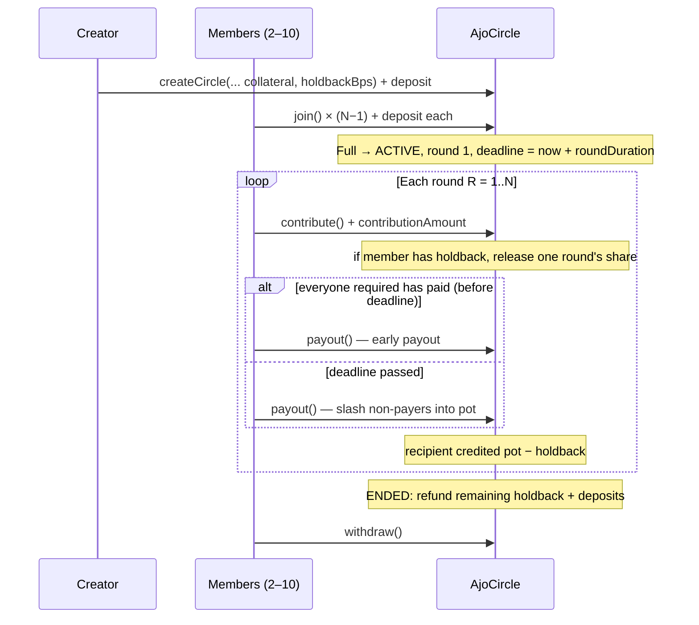

# AjoCircle v5 — Design Document

**Status:** Implemented and deployed  
**Deployed at:** `0x64822c48a4de920e74d16df88cb3b0b6924819d6` (Arc Testnet, chain ID 5042002, 2026-10-24)  
**Language/toolchain:** Solidity ^0.8.20 / Foundry  
**Milestones covered:** holdback + trust levels + reputation (fix 6), native USDC one-signature payments (fix 7)

**Review tracker:**
- [ ] Design review
- [ ] Security review
- [ ] Ops review

> History: v2 introduced a "bond" that locked 100% of everything an early recipient still owed. v5 replaces it with a configurable **holdback** (0–30%), makes the join deposit optional, adds global reputation and early payout, and moves from ERC-20 USDC + approvals to native USDC sent as `msg.value`.

---

## Goals / Non-Goals

### Goals
1. Rotating savings group (ajo/esusu) in USDC: every member contributes each round, one member receives the pot per round, in join order.
2. **Let each circle choose how much it trusts its members.** A creator picks a holdback percentage (0–30%). Friends can run with no holdback; strangers can require more.
3. **Keep early recipients paying.** At payout, a share of what the recipient still owes is held back and released one round at a time as they keep contributing.
4. **Cover missed rounds.** A member who misses a round is slashed one contribution, from holdback first and then from their deposit, and it goes to that round's recipient.
5. **Optional deposit** at join (`collateralAmount`, may be 0) covers members who miss before they have been paid.
6. **Portable reputation:** count rounds paid, rounds missed and circles completed per address, across all circles.
7. **Early payout:** pay out as soon as everyone required has paid, without waiting for the deadline.
8. **One signature per action:** pay with native USDC (`msg.value`), no ERC-20 approvals.
9. At cycle end, refund all remaining holdback and deposits.

### Non-Goals
- Cross-chain / bridging.
- Upgradeability (immutable contract).
- Admin / owner keys.
- Randomised payout order (`block.prevrandao` is always 0 on Arc Testnet).
- Fee-on-transfer or non-USDC tokens.

---

## Parameters (per circle)

| Parameter | Range | Meaning |
|---|---|---|
| `contributionAmount` | > 0 | Amount each member pays per round (6-decimal USDC units) |
| `memberCount` | 2–10 | Circle size; also the number of rounds |
| `roundDuration` | ≥ 300 s | Time allowed per round (UI offers 5 min demo, 1 day, 1 week, 2 weeks, 1 month) |
| `collateralAmount` | ≥ 0 | Deposit paid at join; 0 = no deposit |
| `holdbackBps` | 0–3000 | Holdback in basis points (0–30%) |

**Trust level presets (UI only):** Friends = 0, Mixed = 1000 (10%), Strangers = 2500 (25%), or a custom value up to 3000.

---

## Units: native USDC

On Arc, USDC is the native gas token with 18 decimals. The contract keeps every balance in 6-decimal USDC units and converts at the edges:

- Incoming: `msg.value` must equal `amount × 1e12` exactly, otherwise `IncorrectPayment()`.
- Outgoing: `withdraw()` sends `pendingWithdrawals × 1e12` via a low-level `call`.

Native USDC sent to the contract outside `createCircle` / `join` / `contribute` (e.g. via `selfdestruct`) is unrecoverable. This is accepted for a no-admin design.

The `USDC` constant (`0x3600…0000`) is kept for reference but not called.

---

## Terminology

| Term | Definition |
|---|---|
| Circle | One savings group, identified by `uint256 circleId` |
| Member | An address that joined (and paid the deposit, if any) |
| Deposit | `collateralAmount` locked at join. Covers missed rounds. |
| Holdback | Part of a payout locked back from the recipient: `holdbackBps × roundsStillOwed × contributionAmount / 10000`. Released as they keep paying. |
| Round | One contribution cycle; exactly one designated recipient |
| Recipient | `payoutRecipients[round − 1]` (join order) |
| Pot | Sum of contributions, slashed amounts and any carried-over pot for the round |
| Defaulted | Permanently excluded: holdback **and** deposit are both exhausted |

---

## Lifecycle

---

## Function Behaviour

### `createCircle`
Validates parameters (`InvalidContributionAmount`, `InvalidMemberCount`, `InvalidRoundDuration`, `InvalidHoldbackBps`), stores the circle as PENDING, then runs `_join` for the creator.

### `join` / `_join`
- Requires PENDING, not already a member, not full.
- If `collateralAmount > 0`: `msg.value` must equal `collateralAmount × 1e12`; records `memberDeposit`. Otherwise `msg.value` must be 0.
- Appends to `members` and `payoutRecipients` (payout order = join order).
- When the circle is full: status ACTIVE, `currentRound = 1`, deadline set.

### `contribute`
- Requires ACTIVE, member, not defaulted, not already paid this round, deadline not passed.
- `msg.value` must equal `contributionAmount × 1e12`.
- Adds to the round pot and increments `totalRoundsPaid`.
- If the member has holdback locked, releases `contributionAmount × holdbackBps / 10000` (capped at what remains) to `pendingWithdrawals`.

### `payout`
Callable by anyone while ACTIVE.

1. **Before the deadline (early payout):** every member who is not defaulted and is not the recipient must have paid, otherwise `ContributionsStillPending`. The recipient does not have to pay their own round.
2. **After the deadline:** `_slashDefaulters` runs for every member who is not defaulted, has not paid, and is not the recipient:
   - `totalRoundsMissed++`
   - Slash up to one `contributionAmount`: from holdback first, then from deposit.
   - The slashed amount is added to this round's pot (so it goes to this round's recipient).
   - If both holdback and deposit are now zero, the member is permanently `isDefaulted`.
3. **Recipient already defaulted (excluded before this round):** the pot is carried forward to the next round. In the final round it goes to `_terminalPotDistribution` instead.
4. **Normal recipient:**
   - `roundsStillOwed = memberCount − round` (0 for the last recipient)
   - `holdback = holdbackBps × roundsStillOwed × contributionAmount / 10000`, capped at the pot
   - Recipient is credited `pot − holdback`; `memberHoldback` increases by `holdback`.
5. Advance the round. After the last round, `_endCircleAndRefund`.

### `_terminalPotDistribution` (final round, excluded recipient)
Splits the pot equally among members who paid that round. If none paid, among non-defaulted members. If everyone is defaulted, the creator receives it. Rounding dust goes to the first eligible member.

### `_endCircleAndRefund`
Status ENDED. Every member's remaining holdback + deposit is credited to `pendingWithdrawals`. Every member not permanently defaulted gets `totalCirclesCompleted++`.

### `cancelCircle`
Creator only, PENDING only. Refunds all deposits and marks the circle ENDED.

### `withdraw`
Zeroes `pendingWithdrawals[msg.sender]` and then sends `amount × 1e12` native USDC. If the transfer fails it reverts with `NothingToWithdraw` (no dedicated error), so the balance is preserved.

---

## Flow of Funds

| Step | Movement | Note |
|---|---|---|
| `join` | Member → contract: `collateralAmount` | `memberDeposit` set |
| `contribute` | Member → contract: `contributionAmount` | `roundPot += contribution` |
| Holdback release | `memberHoldback −= share` → `pendingWithdrawals += share` | On each contribution while holdback > 0 |
| Slash | `memberHoldback` / `memberDeposit` → `roundPot` | One contribution max per missed round |
| `payout` | `roundPot` → `pendingWithdrawals[recipient]` (minus holdback) | Holdback → `memberHoldback[recipient]` |
| Carry-over | `roundPot[R] → roundPot[R+1]` | Recipient already excluded |
| End | Remaining holdback + deposit → `pendingWithdrawals` | All members |
| `withdraw` | Contract → member | Balance zeroed before transfer |

**Resting-state invariant:** after a circle ends and all members withdraw, the contract holds no USDC attributable to that circle (tested in `test_ContractBalanceZero_AfterFullCycle`).

---

## Reputation

Global per address, across all circles:

| Counter | Incremented when |
|---|---|
| `totalRoundsPaid` | Member contributes a round |
| `totalRoundsMissed` | Member is slashed for missing a round |
| `totalCirclesCompleted` | A circle ends and the member is not permanently defaulted |

Read with `getMemberReputation(address)`. The circle page shows it next to each member. It is informational only; the contract never uses it to gate anything.

---

## Security Considerations

| Concern | Mitigation |
|---|---|
| Reentrancy | `nonReentrant` on every state-changing entry point; CEI ordering; `withdraw` zeroes balance before sending (tested with `ReentrantWithdraw`) |
| Access control | No admin. Creator can only cancel a PENDING circle. Payout is permissionless. |
| Wrong payment amount | Exact `msg.value` match required on join and contribute |
| Integer overflow | Solidity 0.8 checked arithmetic; holdback capped at pot; slashes capped at available balance |
| Denial of service | Pull payments only; loops bounded by `memberCount ≤ 10` |
| Timestamp dependence | Deadlines use `block.timestamp`; minimum round 300 s; not used for randomness |
| Stuck native USDC | Funds sent outside entry points cannot be recovered (accepted) |
| Centralization | No owner, no upgrade path |

## Threat Model

| Actor | Worst case | Mitigation |
|---|---|---|
| Creator | Cancels a pending circle | Deposits refunded to each member, not the creator |
| Early recipient | Takes the pot and stops paying | Holdback is slashed one contribution per missed round to that round's recipient. With 0% holdback and no deposit, nothing protects later members — the creator chose "Friends" trust. |
| Member who never pays | Misses rounds | Slashed from deposit; excluded once deposit and holdback are gone; their slot's pot carries forward |
| Reentrancy attacker | Re-enters `withdraw` | `nonReentrant` + balance zeroed first |

---

## Known Limitations

- With low holdback and no deposit, protection for later recipients is weak by design. The UI explains this per trust level.
- A member is not marked defaulted until both their holdback and deposit are exhausted, so a partially slashed member keeps contributing and keeps their slot.
- `withdraw()` reuses `NothingToWithdraw` when the native transfer fails, which is misleading for callers.
- The recipient is never slashed for not paying their own round; their pot is simply one contribution smaller.

---

## Testing

58 Foundry tests (`forge test`):

- `AjoCircle.Core.t.sol` (35): create/join/contribute/payout/cancel/withdraw paths, all revert cases, view functions, fuzzed parameters.
- `AjoCircle.Holdback.t.sol` (23): friends mode, 25% holdback with 10 members, holdback lock/release/slash, pre-payout defaulter skipped, early payout, native `msg.value` payments, reputation counters, reentrancy, zero-balance invariant, fuzzed holdback ≤ pot.
